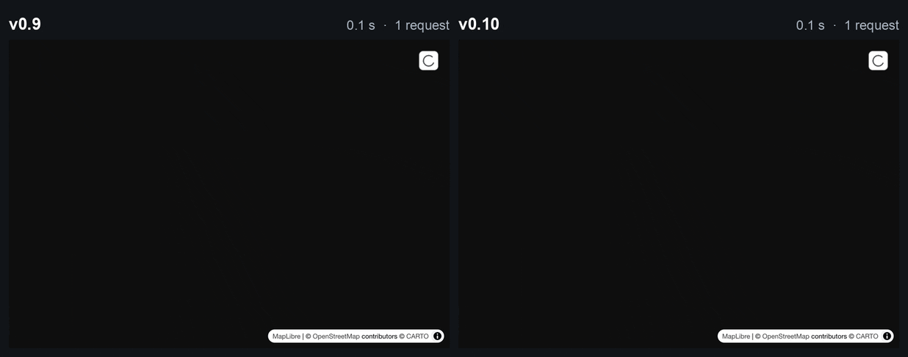
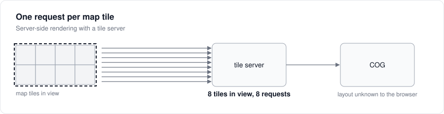
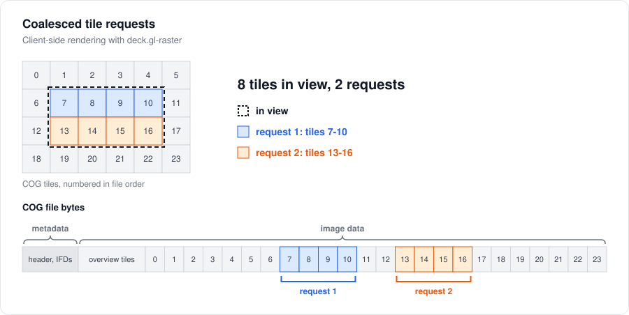
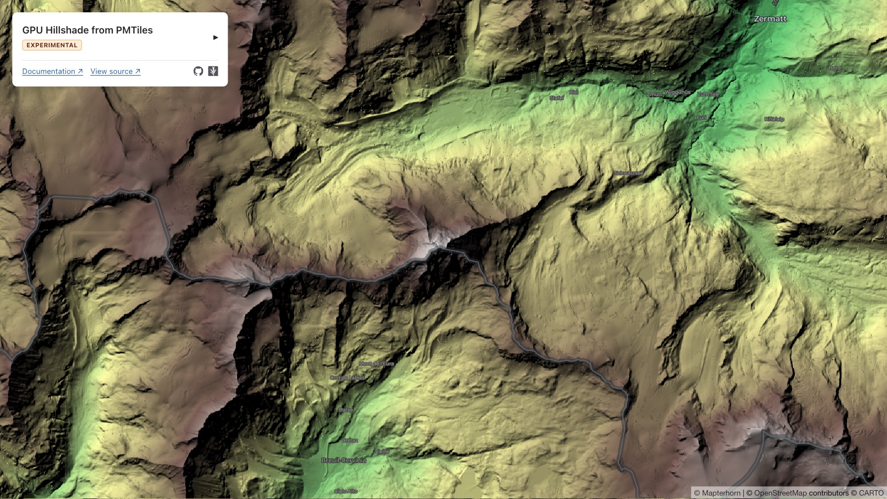
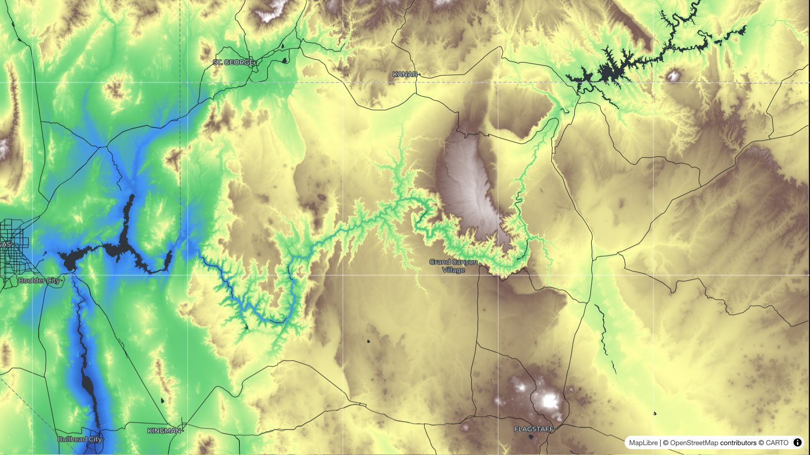

_This blog post was human written._

{/* truncate */}


## COG tile range request coalescing

The `COGLayer` now merges and combines neighboring tile requests automatically. We see up to 4x faster loading in the [USGS topographic map example][usgs-topo-example]:

[][usgs-topo-example]

This is newly possible because client-side rendering has more information about a file's underlying byte layout than a comparable server-side rendering approach would have.

In the **prior server-side rendering approach**: if you have 8 COG tiles on screen, you'd need to send out 8 standalone requests, one for each tile. The client code has no way to optimize this, because only the tile server knows that the byte ranges for these tiles are actually close together in the COG file.



Sending out parallel requests like this isn't _always_ a bad idea, but it's particularly bad over HTTP/1.1, where **Chrome allows a maximum of six current requests at a time** to the same origin. Since many object storage buckets (especially AWS S3) only support serving HTTP requests over HTTP/1.1, it's especially important to reduce the total number of concurrent requests. This makes the biggest difference when those requests are small.

Compare to our **new client-side rendering approach**: since we have the full metadata of the COG in the client, we know that among those 8 tiles, they group into two adjacent runs of bytes. Therefore, we can make just two requests to cover the entire image.



Then within each of these merged request ranges, we make use of the _streaming_ request. As soon as the stream has finished loading content for the first tile, we start decoding the image bytes for that tile. This helps to maintain fast latency rather than waiting for the entire coalesced request to finish before rendering anything.

[usgs-topo-example]: https://developmentseed.org/deck.gl-raster/examples/usgs-topo/

Note that the USGS historical topographic data source is particularly sped-up by COG tile merging because its tiles are only 128x128 pixels. The smaller the tile size, the larger the gains from coalescing.

We plan to also implement range coalescing for sharded Zarr datasets in a future release.

## New examples

### Mapterhorn PMTiles Terrain rendering

Thanks TODO for creating these tiles

- pmtiles-terrain: GPU hillshade of Mapterhorn PMTiles ([#817])

[][pmtiles-mapterhorn example]

[pmtiles-mapterhorn example]: https://developmentseed.org/deck.gl-raster/examples/pmtiles-terrain/


### GDAL VRT Mosaic

We also export a new `parseVRT` helper to parse a GDAL VRT XML file as mosaic items ([#835]).

[][vrt-mosaic]

[vrt-mosaic]: https://developmentseed.org/deck.gl-raster/examples/vrt-mosaic/


- vrt-mosaic: GDAL VRT mosaic ([#835])

### Zarr globe rendering

[][zarr-globe example]

[zarr-globe example]: https://developmentseed.org/deck.gl-raster/examples/zarr-globe/


- zarr-globe: ECMWF AIFS 2 m temperature forecast on a globe ([#794])


## New "Sources" API to share data across layers

We have a new API to let you open up a reference once and use it across multiple layers. The `COGSource`, `MultiCOGSource`, `ZarrSource` classes cache the metadata of a give data source so that separate layers don't have to re-open and re-parse the same underlying metadata.

In the future, we'll also implement data caching so that multiple layers can render from the same inputs without downloading twice.


## MosaicLayer


- Items as `data`; `getSource` opens only items in view; `renderSource` draws them ([#804])
- `renderSource` gets the sublayer props ([#789])
- Items out of view keep their source, drop their layers and GPU memory ([#839])
- Examples drop their own source caches ([#842])
- `updateTriggers.getSource` opens sources again ([#848])
- Keeps drawing after an item fails to open ([#833]); `onSourceError` fires ([#860]); `onSourceUnload` on removal ([#823])

## Zarr

The new `ZarrSource` applies relevant GeoZarr metadata from a Zarr Group onto the child Array ([#838]).

Since

- `source.is(dtype)` type guard; `source.levels` ([#838])


## Reliability

We've fixed several memory leaks, see [#786] and [#834].

- WebGL vertex array leak per tile
- Palette COG colormap texture leak ()
- Parent tile picked by centre in `RasterTileset2D` ([#841])
- Globe mesh latitudes clamped to the poles ([#858])
- Unused dependencies dropped ([#859])
- Docs: intro, package READMEs, API cross-package links ([#865]); decoder pool docs ([#802])

## Upgrade notes

:::info[Written by Claude]

The upgrade notes section was written by an LLM (Claude Code).

:::

Every layer now takes its data as `source`: either a source you opened, or the input for the layer to open one from, such as a URL or a Zarr store. TypeScript flags the removed props below. JavaScript ignores them without a warning, so a layer that still gets only its old props draws nothing.

### COGLayer

- `geotiff` is now `source`, and takes the same inputs ([#799]).
- `onGeoTIFFLoad` is now `onSourceLoad`, which gets the opened `COGSource`. Its `geotiff`, `projection` and `geographicBounds` hold what `onGeoTIFFLoad` used to receive. It's called only when the layer opens the source itself.
- `epsgResolver` and `concurrencyLimiter` are now options of `COGSource.open`.
- `COGLayer` and `MultiCOGLayer` now default to `maxRequests: 256` and `debounceTime: 50`, so the tiles in view reach the range reader together. A per-origin limiter, six requests at a time, caps the requests instead ([#809]).

```ts
// 0.9
new COGLayer({
  geotiff: url,
  onGeoTIFFLoad: (geotiff, { geographicBounds }) => fit(geographicBounds),
});

// 0.10
new COGLayer({
  source: url,
  onSourceLoad: (source) => fit(source.geographicBounds),
});

// 0.10, with options
const source = await COGSource.open(url, { epsgResolver });
new COGLayer({ source });
```

### MultiCOGLayer

- `sources` is now `source`, without the `{ url }` wrapper, and `MultiCOGSourceConfig` is removed ([#801]).
- `onGeoTIFFLoad` is now `onSourceLoad`, which gets the opened `MultiCOGSource`. Its `geotiffs`, `geographicBounds` and `multiTilesetDescriptor.primaryKey` hold what `onGeoTIFFLoad` used to receive.
- `epsgResolver` and `concurrencyLimiter` are now options of `MultiCOGSource.open`.
- Files that don't share a CRS and an extent are now rejected. 0.9 drew them all in the first file's CRS.

```ts
// 0.9
new MultiCOGLayer({ sources: { red: { url: redUrl }, nir: { url: nirUrl } } });

// 0.10
new MultiCOGLayer({ source: { red: redUrl, nir: nirUrl } });
```

### MosaicLayer

- `sources` is now `data`, and the `MosaicSource` type is now `MosaicItem` ([#804]).
- The callbacks get the item first and the opened source as `source`, where they used to get `data`. `renderSource` no longer gets a `signal` ([#821]), and it now gets `subLayerProps` to spread onto the layer it returns ([#789]).
- `onViewportLoad`'s entries are now `{ item, source }` instead of `{ source, data }`, so `entry.source` is now the opened source rather than the item. With `SourceT` left at its default of `any`, TypeScript doesn't catch code that still reads it as the item, so check every `onViewportLoad`, `onSourceLoad` and `onSourceUnload`.
- `maxCacheByteSize` is removed ([#843]). `maxCacheSize` still sets how many items keep their opened source. To bound memory by bytes, set `maxCacheByteSize` on the layer that `renderSource` returns.
- Items out of view now drop their layers and GPU memory, and keep only their opened source ([#839]).

```ts
// 0.9
new MosaicLayer({
  sources: items,
  getSource: (item, { signal, concurrencyLimiter }) =>
    GeoTIFF.fromUrl(item.url, { signal, concurrencyLimiter }),
  renderSource: (item, { data, signal }) =>
    new COGLayer({ id: item.url, geotiff: data, signal }),
});

// 0.10
new MosaicLayer({
  data: items,
  getSource: (item, options) => COGSource.open(item.url, options),
  renderSource: (item, { source, subLayerProps }) =>
    new COGLayer({ ...subLayerProps, source }),
});
```

### ZarrLayer

- `node`, `variable`, `metadata` and `epsgResolver` are removed ([#812]). Pass a zarrita store, or an opened group or array, as `source`. For options, open a `ZarrSource` first: `path` replaces `variable`, `geoZarrMetadata` replaces `metadata`, and `epsgResolver` moves there too ([#838]).
- `ZarrLayer<Store, Dtype, DataT>` is now `ZarrLayer<DataT, Dtype>`, and `ZarrLayerProps` changes the same way. `ZarrSource.open` returns a general `ZarrSource`: narrow its data type with `source.is("float32")`.
- A change to `selection` now fetches tiles again ([#818]), so apps that put the selection in the layer's `id` to force a reload can drop it.
- An array now inherits its group's `proj:` and `spatial:` attributes ([#838]). `spatial:dimensions` is read by position, Y then X, as v0.1 of the spatial convention says ([#785]). Multiscales levels are sorted finest first by pixel size ([#851]).

```ts
// 0.9
new ZarrLayer({
  node: group,
  variable: "temperature",
  metadata: attrs,
  selection,
  getTileData,
  renderTile,
});

// 0.10
const source = await ZarrSource.open(store, {
  path: "temperature",
  geoZarrMetadata: attrs,
});
new ZarrLayer({ source, selection, getTileData, renderTile });
```

### @developmentseed/geotiff

- `GeoTIFF.fromUrl` no longer takes `chunkSize` or `cacheSize` ([#807]). They're now options of a `RangeReader`, `minMetadataReadBytes` and `cache.metadataBytes`, which you pass to `fromUrl` as `reader`.

[#723]: https://github.com/developmentseed/deck.gl-raster/issues/723
[#785]: https://github.com/developmentseed/deck.gl-raster/pull/785
[#786]: https://github.com/developmentseed/deck.gl-raster/pull/786
[#788]: https://github.com/developmentseed/deck.gl-raster/pull/788
[#789]: https://github.com/developmentseed/deck.gl-raster/pull/789
[#790]: https://github.com/developmentseed/deck.gl-raster/pull/790
[#791]: https://github.com/developmentseed/deck.gl-raster/pull/791
[#792]: https://github.com/developmentseed/deck.gl-raster/pull/792
[#794]: https://github.com/developmentseed/deck.gl-raster/pull/794
[#799]: https://github.com/developmentseed/deck.gl-raster/pull/799
[#801]: https://github.com/developmentseed/deck.gl-raster/pull/801
[#802]: https://github.com/developmentseed/deck.gl-raster/pull/802
[#804]: https://github.com/developmentseed/deck.gl-raster/pull/804
[#805]: https://github.com/developmentseed/deck.gl-raster/pull/805
[#806]: https://github.com/developmentseed/deck.gl-raster/pull/806
[#807]: https://github.com/developmentseed/deck.gl-raster/pull/807
[#809]: https://github.com/developmentseed/deck.gl-raster/pull/809
[#812]: https://github.com/developmentseed/deck.gl-raster/pull/812
[#815]: https://github.com/developmentseed/deck.gl-raster/pull/815
[#817]: https://github.com/developmentseed/deck.gl-raster/pull/817
[#818]: https://github.com/developmentseed/deck.gl-raster/pull/818
[#820]: https://github.com/developmentseed/deck.gl-raster/pull/820
[#821]: https://github.com/developmentseed/deck.gl-raster/pull/821
[#823]: https://github.com/developmentseed/deck.gl-raster/pull/823
[#833]: https://github.com/developmentseed/deck.gl-raster/pull/833
[#834]: https://github.com/developmentseed/deck.gl-raster/pull/834
[#835]: https://github.com/developmentseed/deck.gl-raster/pull/835
[#837]: https://github.com/developmentseed/deck.gl-raster/pull/837
[#838]: https://github.com/developmentseed/deck.gl-raster/pull/838
[#839]: https://github.com/developmentseed/deck.gl-raster/pull/839
[#841]: https://github.com/developmentseed/deck.gl-raster/pull/841
[#842]: https://github.com/developmentseed/deck.gl-raster/pull/842
[#843]: https://github.com/developmentseed/deck.gl-raster/pull/843
[#848]: https://github.com/developmentseed/deck.gl-raster/pull/848
[#851]: https://github.com/developmentseed/deck.gl-raster/pull/851
[#856]: https://github.com/developmentseed/deck.gl-raster/pull/856
[#858]: https://github.com/developmentseed/deck.gl-raster/pull/858
[#859]: https://github.com/developmentseed/deck.gl-raster/pull/859
[#860]: https://github.com/developmentseed/deck.gl-raster/pull/860
[#861]: https://github.com/developmentseed/deck.gl-raster/pull/861
[#864]: https://github.com/developmentseed/deck.gl-raster/pull/864
[#865]: https://github.com/developmentseed/deck.gl-raster/pull/865
