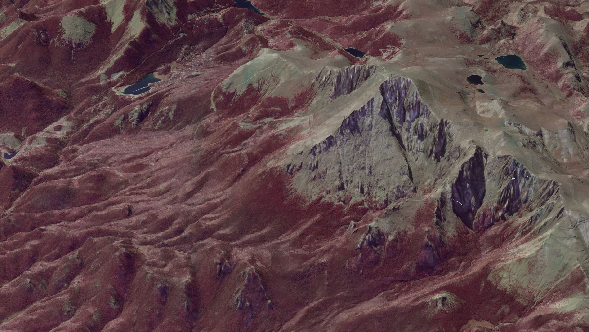
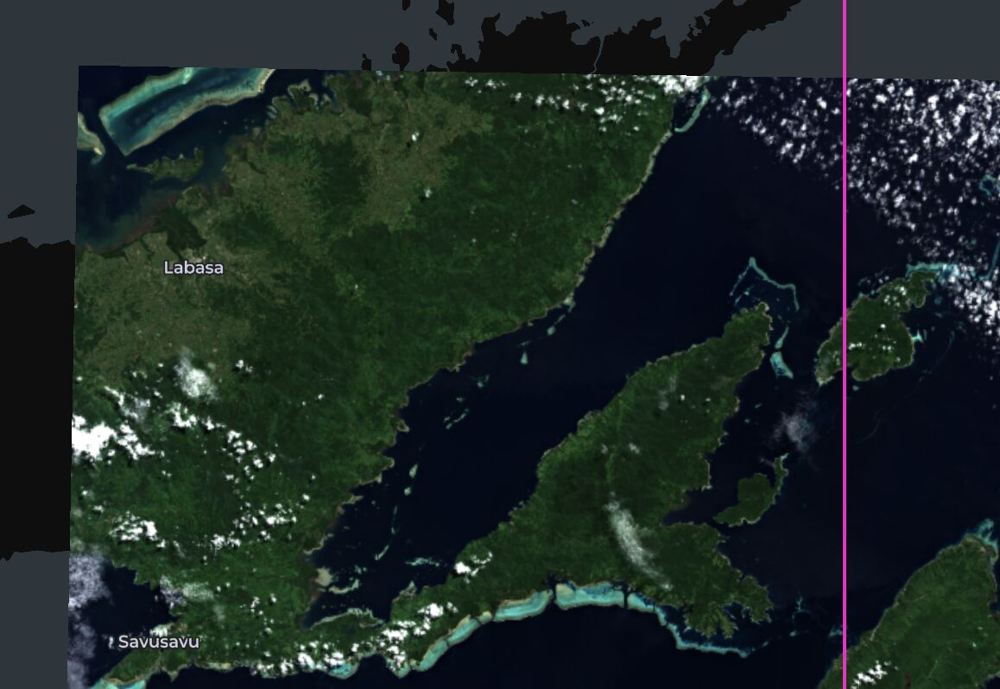
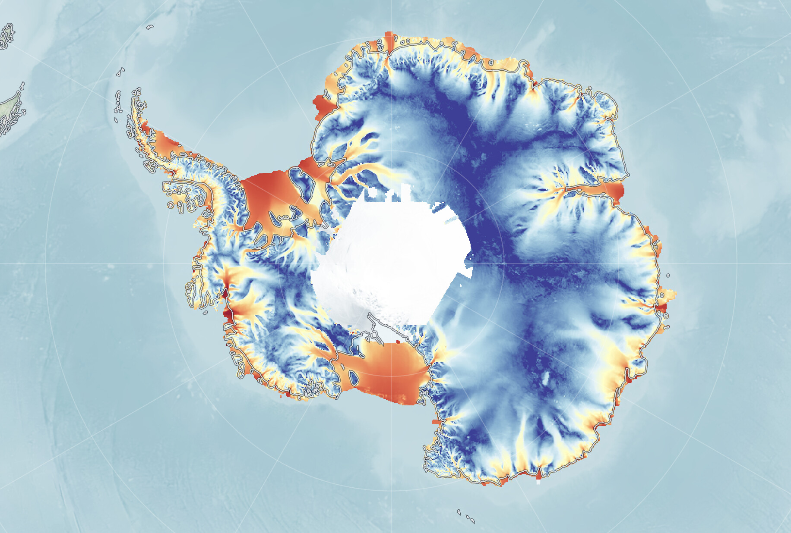
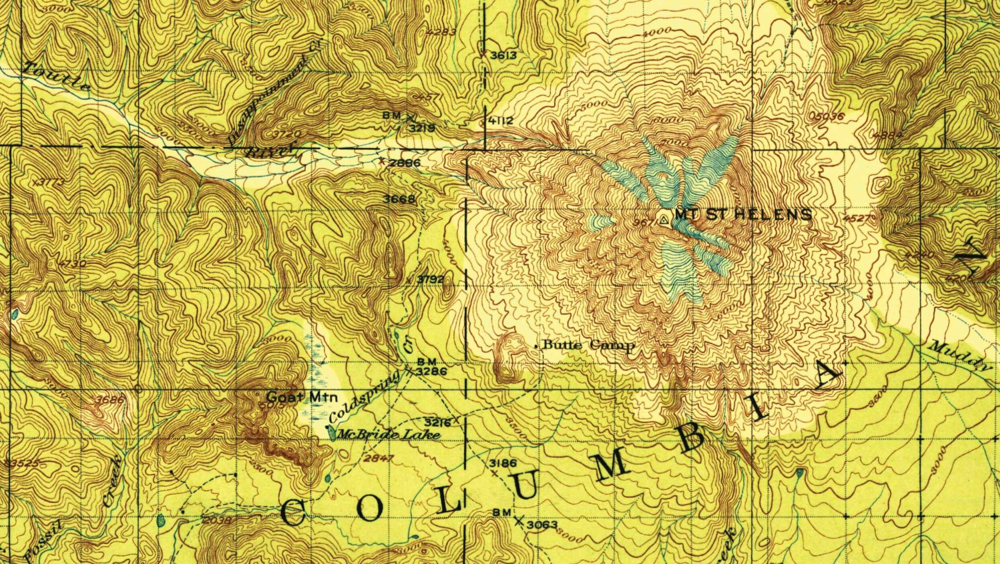
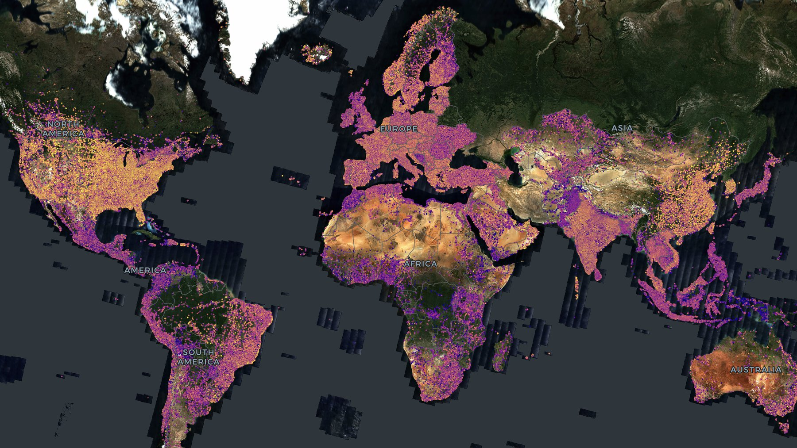
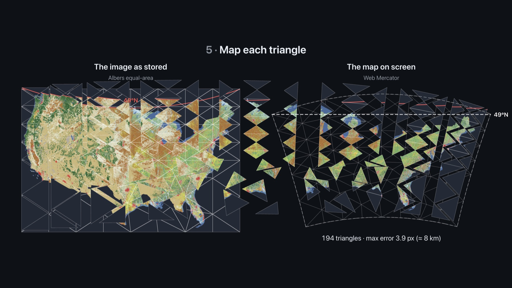
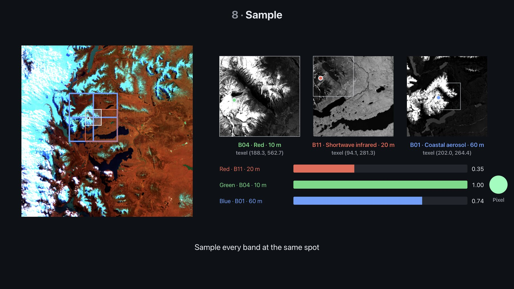
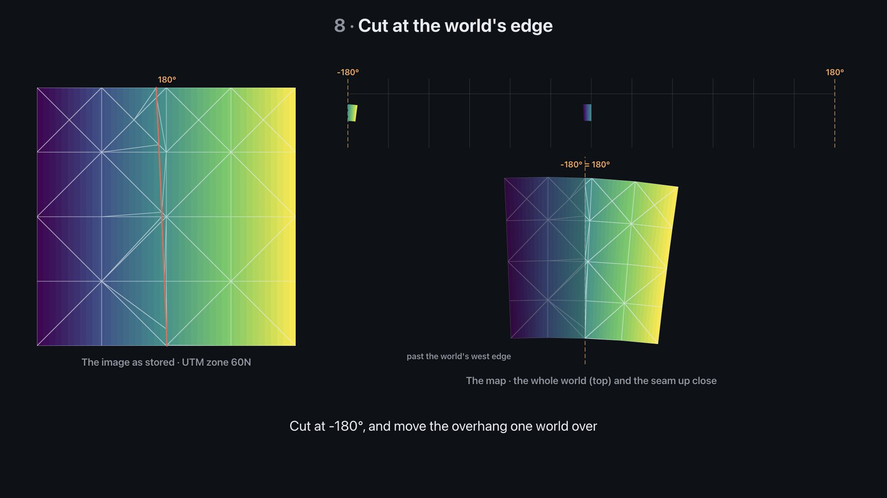

_This blog post was human written._

deck.gl-raster enables GPU-accelerated [Cloud-Optimized GeoTIFF][cogeo] (COG) and [Zarr] visualization in [deck.gl].

This release [fixes antimeridian handling](#antimeridian-handling), [widens our GeoTIFF support](#wider-geotiff-support), adds several [new examples](#new-examples), and adds [interactive "explainers"](#explainers) for understanding how the library works under the hood.

[][cog-terrain example]

[cogeo]: https://cogeo.org/
[Zarr]: https://zarr.dev/
[deck.gl]: https://deck.gl/

{/* truncate */}

## Antimeridian handling

We now correctly render images that span the antimeridian in Web Mercator view. Here, an image of Fiji correctly renders (the pink vertical line is the antimerdian).

A lot of work went on under the hood to make this happen. We modified parts of the algorithm to calculate the projection ([#711], [#721]); we now only require a _forward_ projection and not also an inverse projection. This made it easier to handle antimeridian-crossing images in ([#716] and [#721]).

We have a new [interactive explainer](#antimeridian-explainer) that details how the rendering process works.

## Wider GeoTIFF support

We've improved our support for various types of GeoTIFF files:

- We now support band-separate GeoTIFFs in the default loading pipeline ([#635], [@thatbudakguy])
- We now support rendering 16-bit images in Firefox ([#773]). Previously they wouldn't render because Firefox doesn't support that extension to WebGL2 ([#648]).
- We now support decoding big-endian GeoTIFFs ([#687] [@james-willis], [#705])
- We fixed an issue with loading JPEG metadata for JPEG-encoded GeoTIFFs ([#769])
- We now correctly use any available alpha band in the default rendering pipeline, rather than assuming the 4th band is an alpha band ([#732]).

## MultiCOGLayer improvements

- We've fixed rendering of edge tiles, ensuring no black regions render for images with edge padding ([#755], [#753])
- There's a new `resampling` prop to choose linear or nearest pixel resampling ([#775]; from [@willjnz]'s [#640])

## Reliability and performance

- Faster performance for selecting which tiles should be rendered ([#689])
- Common EPSG codes (4326, 3857, UTM) no longer require a network request to resolve ([#760]).
- We fixed a memory leak where GPU textures weren't freed on layer removal ([#728])
- We now abort loading GeoTIFF metadata when the GeoTIFF url changes ([#770], [@charlieforward9])
- When a decoder worker fails, it now errors instead of hanging ([#771], [@charlieforward9])
- Previously, if we were fetching multiple tiles and cancelled one of them, the others would sometimes fail to load. That should now be fixed ([#709]).

## New examples

We have two new sections on the [examples page](/examples): "experimental" examples and "explainer" examples.

"Experimental" examples are LLM/Claude-written examples where I haven't had time to manually verify and optimize their source code. So they may not use the best code, but they work and show off various capabilities. Experimental examples may be promoted to "primary" examples in the future.

"Explainer" examples depict how internals of deck.gl-raster work, and may be useful for any curious at a deeper level.

### Custom projections (preview)

deck.gl is [currently working on](https://github.com/visgl/deck.gl/issues/10739) support for arbitrary viewing projections, and they plan to release it as part of deck.gl's next release, v10.

The custom projections example here in deck.gl-raster gives a preview of what will be capable in production code once deck.gl v10 is released.

[][custom projections example]

[custom projections example]: https://developmentseed.org/deck.gl-raster/examples/custom-projection/

See [#694] and [#695] for more information.

### Draping rasters over terrain

We have [a new example][cog-terrain example] for rendering a raster layer over a 3d terrain surface. This uses the deck.gl [`TerrainExtension`] to match the raster layers to the terrain surface.

[][cog-terrain example]

[`TerrainExtension`]: https://deck.gl/docs/api-reference/extensions/terrain-extension
[cog-terrain example]: https://developmentseed.org/deck.gl-raster/examples/cog-terrain/

See [#720] and [#731] for more information.

### USGS topographic maps

[This example][usgs topo example] renders images from the [USGS Historical Topographic Map Collection](https://www.usgs.gov/programs/national-geospatial-program/historical-topographic-maps-preserving-past).

It shows how to use the deck.gl [`ClipExtension`](https://deck.gl/docs/api-reference/extensions/clip-extension) to avoid rendering parts of the image (in this case, the map collar around the map itself).

[][usgs topo example]

[usgs topo example]: https://developmentseed.org/deck.gl-raster/examples/usgs-topo/

### GeoArrow overlay

One of the selling points of deck.gl-raster is that you can interleave [any other deck.gl layers](https://deck.gl/examples) on the same map.

This example uses GeoArrow layers from [deck.gl-geoarrow](https://github.com/geoarrow/deck.gl-geoarrow) to render millions of points alongside a global basemap loaded from a COG.

[][geoarrow example]

[geoarrow example]: https://developmentseed.org/deck.gl-raster/examples/geoarrow-overlay/

### Loading tiles via a server

While deck.gl-raster is most commonly used with client-side loading, where the frontend fetches from COG or Zarr files directly, it isn't a requirement.

At the core, if you use the `RasterTileLayer` directly, deck.gl-raster only requires three things:

1. A description of where tiles exist: what Coordinate Reference System, how many tiles, and are there multiple resolutions?
2. A function callback for how to load data for each tile
3. A function callback for how to render data from each tile

The new [server-side-loading example][titiler-example] loads tiles from [titiler] but then renders them through deck.gl-raster's GPU enabled render pipeline.

[titiler]: https://github.com/developmentseed/titiler
[titiler-example]: https://developmentseed.org/deck.gl-raster/examples/titiler-cog/

## Explainers

### GPU-powered reprojection explainer

[This explainer][reprojection explainer] is a set of interactive slides to explain how our GPU-based reprojection works.

[][reprojection explainer]

[reprojection explainer]: https://developmentseed.org/deck.gl-raster/examples/reprojection-explainer/

### Multi-resolution data explainer

[This explainer][multi-cog explainer] is an interactive demo to explain how rendering works with multiple resolutions of data for the same scene, such as in the [Sentinel-2 example].

[Sentinel-2 example]: https://developmentseed.org/deck.gl-raster/examples/sentinel-2/

[][multi-cog explainer]

[multi-cog explainer]: https://developmentseed.org/deck.gl-raster/examples/multi-cog-explainer/

### Antimeridian explainer

[This explainer][antimeridian explainer] is a set of interactive slides to explain how rendering works around the antimeridian on Web Mercator-based maps.

[][antimeridian explainer]

[antimeridian explainer]: https://developmentseed.org/deck.gl-raster/examples/antimeridian-explainer/

## Upgrade notes

- `CutlineBbox` was removed. Use deck.gl's `ClipExtension` instead ([#739])
- `CachedTags` and `.cachedTags` were renamed ([#769])
- `PROJECTION_REGISTRY` now stores promises ([#760])

## Thanks to various contributors

Including: [@willjnz], [@james-willis], [@orshih6], [@thatbudakguy], [@charlieforward9], [@earlybard].

[@willjnz]: https://github.com/willjnz
[@james-willis]: https://github.com/james-willis
[@orshih6]: https://github.com/orshih6
[@thatbudakguy]: https://github.com/thatbudakguy
[@charlieforward9]: https://github.com/charlieforward9
[@earlybard]: https://github.com/earlybard

[#624]: https://github.com/developmentseed/deck.gl-raster/pull/624
[#635]: https://github.com/developmentseed/deck.gl-raster/pull/635
[#639]: https://github.com/developmentseed/deck.gl-raster/pull/639
[#640]: https://github.com/developmentseed/deck.gl-raster/pull/640
[#648]: https://github.com/developmentseed/deck.gl-raster/issues/648
[#650]: https://github.com/developmentseed/deck.gl-raster/pull/650
[#664]: https://github.com/developmentseed/deck.gl-raster/pull/664
[#667]: https://github.com/developmentseed/deck.gl-raster/pull/667
[#669]: https://github.com/developmentseed/deck.gl-raster/pull/669
[#670]: https://github.com/developmentseed/deck.gl-raster/pull/670
[#671]: https://github.com/developmentseed/deck.gl-raster/pull/671
[#684]: https://github.com/developmentseed/deck.gl-raster/pull/684
[#687]: https://github.com/developmentseed/deck.gl-raster/pull/687
[#688]: https://github.com/developmentseed/deck.gl-raster/pull/688
[#689]: https://github.com/developmentseed/deck.gl-raster/pull/689
[#694]: https://github.com/developmentseed/deck.gl-raster/pull/694
[#695]: https://github.com/developmentseed/deck.gl-raster/issues/695
[#696]: https://github.com/developmentseed/deck.gl-raster/pull/696
[#698]: https://github.com/developmentseed/deck.gl-raster/pull/698
[#700]: https://github.com/developmentseed/deck.gl-raster/pull/700
[#702]: https://github.com/developmentseed/deck.gl-raster/pull/702
[#705]: https://github.com/developmentseed/deck.gl-raster/pull/705
[#709]: https://github.com/developmentseed/deck.gl-raster/pull/709
[#711]: https://github.com/developmentseed/deck.gl-raster/pull/711
[#712]: https://github.com/developmentseed/deck.gl-raster/pull/712
[#716]: https://github.com/developmentseed/deck.gl-raster/pull/716
[#718]: https://github.com/developmentseed/deck.gl-raster/pull/718
[#720]: https://github.com/developmentseed/deck.gl-raster/pull/720
[#721]: https://github.com/developmentseed/deck.gl-raster/pull/721
[#727]: https://github.com/developmentseed/deck.gl-raster/pull/727
[#728]: https://github.com/developmentseed/deck.gl-raster/pull/728
[#731]: https://github.com/developmentseed/deck.gl-raster/pull/731
[#732]: https://github.com/developmentseed/deck.gl-raster/pull/732
[#739]: https://github.com/developmentseed/deck.gl-raster/pull/739
[#741]: https://github.com/developmentseed/deck.gl-raster/pull/741
[#743]: https://github.com/developmentseed/deck.gl-raster/pull/743
[#750]: https://github.com/developmentseed/deck.gl-raster/pull/750
[#752]: https://github.com/developmentseed/deck.gl-raster/pull/752
[#753]: https://github.com/developmentseed/deck.gl-raster/pull/753
[#755]: https://github.com/developmentseed/deck.gl-raster/pull/755
[#759]: https://github.com/developmentseed/deck.gl-raster/pull/759
[#760]: https://github.com/developmentseed/deck.gl-raster/pull/760
[#761]: https://github.com/developmentseed/deck.gl-raster/pull/761
[#763]: https://github.com/developmentseed/deck.gl-raster/issues/763
[#766]: https://github.com/developmentseed/deck.gl-raster/pull/766
[#767]: https://github.com/developmentseed/deck.gl-raster/pull/767
[#769]: https://github.com/developmentseed/deck.gl-raster/pull/769
[#770]: https://github.com/developmentseed/deck.gl-raster/pull/770
[#771]: https://github.com/developmentseed/deck.gl-raster/pull/771
[#773]: https://github.com/developmentseed/deck.gl-raster/pull/773
[#775]: https://github.com/developmentseed/deck.gl-raster/pull/775
[#777]: https://github.com/developmentseed/deck.gl-raster/pull/777
[#780]: https://github.com/developmentseed/deck.gl-raster/pull/780
